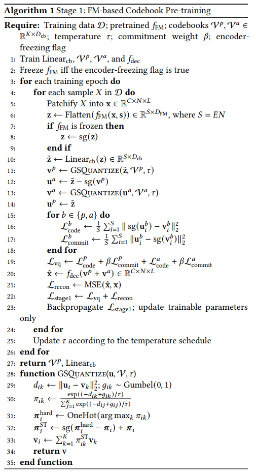
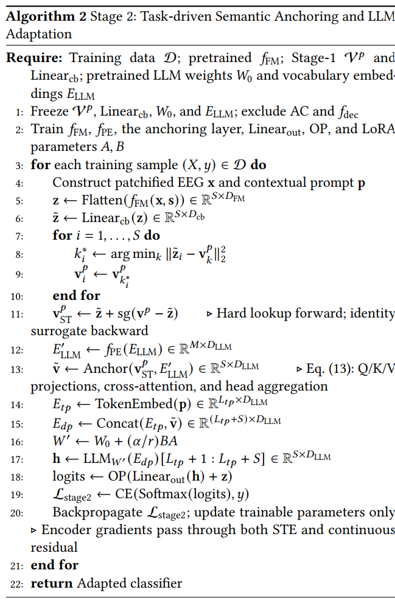

# FMDSA Pseudocode

The algorithms below summarize the two-stage FMDSA training procedure, including tensor dimensions, frozen parameters, stop-gradient operations, and gradient paths.

## Stage 1: FM-based Codebook Pre-training

Learn primary and auxiliary codebooks from pretrained EEG foundation-model representations using hard Gumbel-Softmax quantization, vector-quantization losses, and patch-level reconstruction.

## Stage 2: Task-driven Semantic Anchoring and LLM Adaptation

Use the frozen primary codebook with straight-through estimation, vocabulary-derived semantic anchoring, contextual prompts, and LoRA adaptation for downstream EEG classification.

